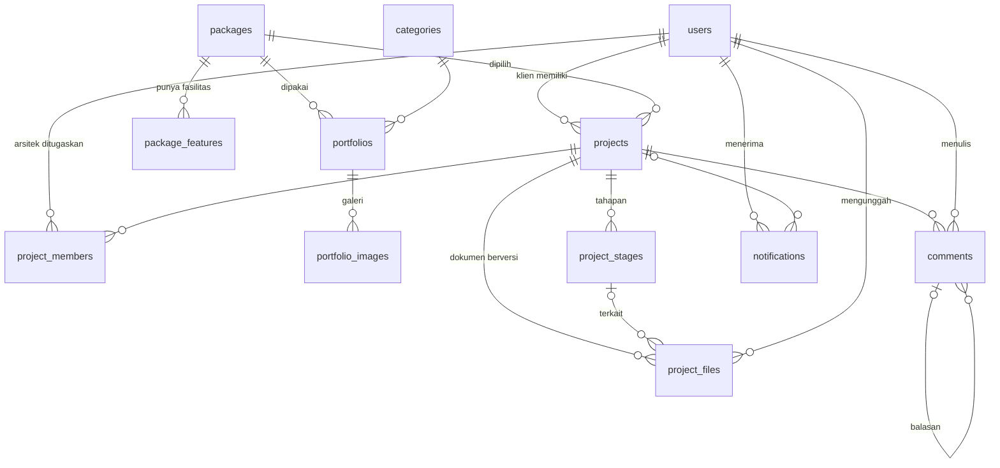

# Senada Studio Platform

Perancangan Platform Digital untuk Mendukung Layanan dan Manajemen Proyek pada Senada Studio Arsitektur
(mini-skripsi Teknik Informatika).

Platform terdiri dari tiga bagian:

1. **Landing page publik**: profil studio, portofolio berfilter kategori, detail proyek, daftar paket dan tarif.
2. **Estimasi paket dan konsultasi via WhatsApp**: calon klien memilih tingkatan dan lingkup paket, mengisi luas bangunan, melihat estimasi, lalu menekan tombol yang membuka WhatsApp dengan pesan yang sudah terisi. Tidak ada data calon klien yang disimpan di server.
3. **Dashboard internal** untuk admin, arsitek, dan klien: kelola paket, portofolio, akun, dan proyek; klien memantau progres proyeknya sendiri.

## Fitur per peran

| Peran | Yang bisa dilakukan |
|---|---|
| Publik | Melihat portofolio dan detail proyek, melihat tarif, menghitung estimasi, chat via WhatsApp |
| Admin | Kelola paket dan tarif, kategori, portofolio dan galeri, akun; buat proyek beserta akun klien; atur tahapan dan penugasan arsitek; ringkasan |
| Arsitek | Lihat proyek yang ditugaskan, ubah status tahapan (progres terhitung otomatis), unggah dokumen dan gambar kerja berversi, balas komentar klien |
| Klien | Hanya melihat proyek miliknya: tahapan, timeline, progres; unduh dokumen; komentar dan ajukan revisi |

Notifikasi (tahapan berubah, dokumen baru, komentar baru) tampil di dashboard.

## Teknologi

| Bagian | Yang dipakai |
|---|---|
| Frontend | React 19 (Vite), React Router, Tailwind CSS 4, Motion (transisi halaman dan reveal gambar), Embla Carousel (slider hero), Lenis (smooth scroll) |
| Backend | Node.js, Express 5 (REST API), Zod (validasi), helmet, CORS, express-rate-limit, Multer |
| Database | MySQL/MariaDB (XAMPP) lewat Prisma ORM 7 (`provider = "mysql"`, adapter MariaDB) |
| Auth | JWT, bcrypt, RBAC di middleware |

Catatan: animasi scroll memakai Motion (`whileInView`), jadi GSAP/ScrollTrigger tidak dipakai.

## Struktur folder

```
client/                      Frontend (Vite + React)
  public/images/             Foto hero (WebP) dan logo
  src/pages/                 Halaman publik (Beranda, Portofolio, ProyekDetail, Paket)
  src/pages/dashboard/       Dashboard (login, admin, proyek, notifikasi)
  src/components/            Navbar, Footer, HeroSlider, RevealImage, SplitTitle, PageTransition, Logo
  src/lib/                   api.js (fetch + token), auth.jsx, estimasi.js (rumus + pesan WhatsApp), format.js
server/                      Backend (Express)
  prisma/schema.prisma       Skema database (dasar ERD)
  prisma/migrations/         Riwayat migrasi
  prisma/seed.js             Data contoh dan akun demo
  src/routes/                Definisi endpoint
  src/controllers/           Validasi input dan bentuk respons
  src/services/              Logika bisnis dan akses database
  src/middlewares/           auth (JWT + RBAC), upload (Multer), errorHandler
  src/validators/            Skema Zod
  test/                      Uji otomatis (node:test)
  uploads/                   Berkas unggahan (tidak masuk git)
    portfolios/              Foto portofolio, publik
    projects/                Dokumen proyek, privat (hanya lewat endpoint berotorisasi)
  setup-db.sql               Skrip membuat database dan pengguna MySQL
```

## Cara menjalankan (Windows + XAMPP)

Prasyarat: Node.js 22.18 atau lebih baru (diuji di Node 24; klien Prisma dimuat sebagai TypeScript), XAMPP (modul **MySQL**).

1. **Nyalakan MySQL** di XAMPP Control Panel (Apache tidak diperlukan).
2. **Buat database dan pengguna.** Ubah `GANTI_PASSWORD` di `server/setup-db.sql`, lalu jalankan lewat phpMyAdmin (tab SQL) atau:
   ```bash
   C:\xampp\mysql\bin\mysql.exe -u root < server/setup-db.sql
   ```
3. **Konfigurasi backend.** Salin `server/.env.example` menjadi `server/.env`, lalu isi:
   - `DATABASE_URL` dan `SHADOW_DATABASE_URL`: ganti `GANTI_PASSWORD` dengan password dari langkah 2.
   - `JWT_SECRET`: string acak minimal 32 karakter, misalnya hasil `node -e "console.log(require('crypto').randomBytes(32).toString('hex'))"`.
4. **Konfigurasi frontend.** Salin `client/.env.example` menjadi `client/.env`, isi `VITE_WHATSAPP_NUMBER` dengan nomor WhatsApp studio format internasional tanpa `+` (contoh `628123456789`). Kosong = tombol WhatsApp nonaktif.
5. **Pasang dependensi, migrasi, dan seed:**
   ```bash
   cd server
   npm install
   npx prisma migrate deploy
   npx prisma generate
   npm run db:seed
   cd ../client
   npm install
   ```
6. **Jalankan** (dua terminal):
   ```bash
   cd server && npm run dev
   ```
   ```bash
   cd client && npm run dev
   ```
   Buka `http://localhost:5173`. API berjalan di `http://localhost:4000`; cek `http://localhost:4000/api/health`.

Saat pengembangan, Vite meneruskan `/api` dan `/uploads` ke server (lihat `client/vite.config.js`).

### Akun demo

Seed membuat satu akun per peran (data contoh): `admin@senada.test`, `arsitek@senada.test`, `klien@senada.test`.
Password demo ada di `server/prisma/seed.js` (konstanta `DEMO_PASSWORD`); ganti sebelum dipakai di luar demo lokal.
Login di `http://localhost:5173/masuk`.

Seed juga membuat 9 paket dengan **tarif dan fasilitas contoh** (belum dikonfirmasi client; ubah lewat Dashboard > Paket dan tarif), 3 kategori, 2 portofolio contoh, dan 1 proyek contoh.

## Skema database

Definisi lengkap ada di `server/prisma/schema.prisma`. Tidak ada tabel tiket: konsultasi berlangsung lewat WhatsApp.



## Daftar endpoint

Semua respons berbentuk `{ "success": true, "data": ... }` atau `{ "success": false, "message": "...", "details": [...] }`.

**Publik (tanpa login)**

| Method | Path | Keterangan |
|---|---|---|
| GET | `/api/health` | Cek server dan database |
| GET | `/api/packages` | Paket aktif beserta tarif per m2 dan fasilitas |
| GET | `/api/categories` | Kategori portofolio |
| GET | `/api/portfolios` | Portofolio terbit; `?category=<slug>`, `?unggulan=true` |
| GET | `/api/portfolios/:slug` | Detail proyek portofolio beserta galeri |

**Auth**

| Method | Path | Keterangan |
|---|---|---|
| POST | `/api/auth/login` | Login (maks. 10 percobaan per 15 menit per IP) |
| GET | `/api/auth/me` | Profil dari token |

**Proyek (perlu login; akses mengikuti peran, lihat bagian Keamanan)**

| Method | Path | Peran | Keterangan |
|---|---|---|---|
| GET | `/api/projects` | semua | Daftar proyek yang boleh diakses |
| GET | `/api/projects/:id` | semua | Rincian proyek dan tahapan |
| PATCH | `/api/projects/:id` | admin | Ubah data proyek dan penugasan arsitek |
| POST | `/api/projects/:id/stages` | admin | Tambah tahapan |
| PATCH | `/api/projects/:id/stages/:stageId` | admin, arsitek | Ubah tahapan (arsitek: hanya status) |
| POST | `/api/projects/:id/stages/:stageId/move` | admin | Geser urutan (`naik`/`turun`) |
| DELETE | `/api/projects/:id/stages/:stageId` | admin | Hapus tahapan |
| GET | `/api/projects/:id/files` | semua | Daftar dokumen dan versinya |
| POST | `/api/projects/:id/files` | admin, arsitek | Unggah dokumen (multipart, field `berkas`) |
| GET | `/api/files/:id/download` | semua | Unduh dokumen (diperiksa hak aksesnya) |
| DELETE | `/api/files/:id` | admin, arsitek pengunggah | Hapus dokumen |
| GET | `/api/projects/:id/comments` | semua | Daftar komentar |
| POST | `/api/projects/:id/comments` | semua | Komentar atau permintaan revisi |
| GET | `/api/notifications` | semua | Notifikasi sendiri dan jumlah belum dibaca |
| PATCH | `/api/notifications/:id/read` | semua | Tandai dibaca |
| POST | `/api/notifications/read-all` | semua | Tandai semua dibaca |

**Admin (`/api/admin/*`, hanya ADMIN)**

| Method | Path | Keterangan |
|---|---|---|
| GET | `/api/admin/summary` | Ringkasan dashboard |
| GET, PATCH | `/api/admin/packages`, `/packages/:id` | Daftar paket; ubah tarif, status, fasilitas |
| POST, PATCH, DELETE | `/api/admin/categories`, `/categories/:id` | Kelola kategori |
| GET, POST | `/api/admin/portfolios` | Daftar (termasuk draf) dan tambah |
| GET, PATCH, DELETE | `/api/admin/portfolios/:id` | Detail, ubah, hapus |
| POST | `/api/admin/portfolios/:id/images` | Unggah foto (multipart, field `gambar`, maks. 10) |
| PATCH, DELETE | `/api/admin/portfolio-images/:id` | Ubah alt/urutan/sampul, hapus foto |
| GET, POST | `/api/admin/users` | Daftar dan buat akun |
| PATCH | `/api/admin/users/:id` | Ubah akun, nonaktifkan, reset password |
| GET, POST | `/api/admin/projects` | Daftar proyek; buat proyek (opsional sekaligus akun klien) |

## Keamanan

- **Password** di-hash dengan bcrypt; pesan login gagal sama untuk email salah maupun password salah.
- **JWT** berlaku 8 jam. Akun diperiksa ke database di setiap request, jadi akun yang dinonaktifkan langsung kehilangan akses.
- **RBAC** di middleware (`requireRole`). Rute `/api/admin/*` hanya untuk ADMIN.
- **Anti-IDOR**: satu fungsi `ambilProyek` (`server/src/services/projectAccess.js`) menentukan akses proyek (admin semua, arsitek yang ditugaskan, klien miliknya). Proyek yang tidak boleh diakses dijawab 404 di semua endpoint (proyek, file, komentar, unduhan). Notifikasi hanya bisa ditandai oleh pemiliknya.
- **Upload**: tipe ditentukan dari ekstensi dan isi file (magic bytes), bukan tipe MIME dari browser; nama file diacak; batas ukuran 5 MB (foto) dan 25 MB (dokumen). Dokumen proyek tidak dilayani statis, hanya lewat endpoint yang memeriksa hak akses.
- **Validasi** semua input dengan Zod; skema arsitek untuk tahapan bersifat `strict` (field lain ditolak).
- **helmet**, CORS dibatasi ke `CLIENT_ORIGIN`, rate limiting umum (300 permintaan per 15 menit) dan khusus login.
- Server menolak start bila `JWT_SECRET` kosong atau lemah.

Keterbatasan yang disadari:
- Token disimpan di `localStorage` (rentan jika ada celah XSS); alternatif produksi: cookie httpOnly.
- `npm audit` melaporkan kerentanan pada dependensi dalam Prisma (`mariadb`, `mysql2`, `deepmerge-ts`) yang belum punya perbaikan non-breaking. Database hanya diakses lokal.
- Foto portofolio dan dokumen disimpan di disk lokal (`server/uploads`); untuk produksi, ganti `server/src/lib/uploads.js` dengan cloud storage.

## Pengujian

Otomatis (butuh MySQL hidup dan seed):

```bash
cd server && npm test     # 14 uji: RBAC, anti-IDOR, upload, tahapan, dokumen, komentar, notifikasi
cd client && npm test     # 3 uji: rumus estimasi, validasi luas, pesan WhatsApp
```

Uji manual yang disarankan untuk sidang:

1. **Publik**: hero (panah, swipe, keyboard), filter portofolio, detail proyek, tabel tarif, kalkulator (ganti paket dan luas; coba huruf atau 0), tombol WhatsApp membuka pesan terisi.
2. **Admin**: ubah tarif lalu cek `/paket`; tambah portofolio, unggah foto, terbitkan, cek di publik; unggah file bukan gambar (harus ditolak); buat proyek beserta akun klien.
3. **Arsitek**: ubah status tahapan (progres berubah), unggah dokumen dua kali dengan nama sama (v1 dan v2), balas komentar.
4. **Klien**: hanya proyek sendiri; tidak ada tombol ubah atau unggah; unduh dokumen; ajukan revisi; notifikasi muncul.
5. **Keamanan**: login klien lalu buka `/dashboard/proyek/<id proyek orang lain>` (harus "tidak ditemukan"); akses `/api/admin/users` dengan token klien (harus 403).
6. **Responsif**: semua halaman di lebar 390 px; `prefers-reduced-motion` aktif mematikan animasi.

## Pekerjaan lanjutan

- Konfirmasi client: tarif dan fasilitas 9 paket, nomor WhatsApp, profil dan kontak studio, foto dan data proyek asli.
- Konversi otomatis ke WebP saat admin mengunggah foto (saat ini foto contoh sudah WebP, unggahan baru disimpan apa adanya).
- Cookie httpOnly untuk token; pemindahan unggahan ke cloud storage.
